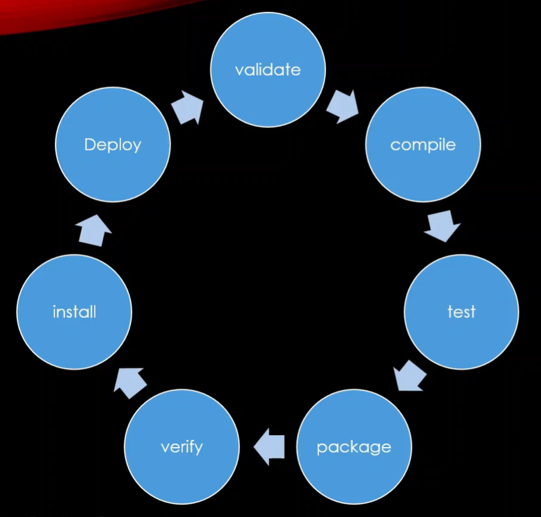

# Maven Lifecycles

Maven has **three built-in lifecycles**:

1. **default** (or build) lifecycle
2. **clean** lifecycle : handles project cleaning
3. **site** lifecycle : handles project documentation

Each lifecycle consists of multiple **phases**.

---

## 1. Default (Build) Lifecycle

The **default lifecycle** handles the full build process (compile, test, package, install, deploy). It is invoked automatically when you run commands like `mvn compile` or `mvn package`.

### Key Phases
| Phase                   | Description                                                             |
|-------------------------|-------------------------------------------------------------------------|
| validate                | Validate project structure and configuration.                           |
| compile                 | Compile the source code of the project.                                 |
| test                    | Run unit tests using a testing framework (e.g., JUnit).                 |
| package                 | Package compiled code into JAR/WAR/EAR.                                 |
| install                 | Install the package into the local Maven repository (~/.m2/repository). |
| deploy                  | Copy the package to a remote repository for sharing with others.        |




### All Phases

| Phase                   | Description                                                             |
|-------------------------|-------------------------------------------------------------------------|
| validate                | Validate project structure and configuration.                           |
| initialize              | Initialize build environment, create directories.                       |
| generate-sources        | Generate any source code required.                                      |
| process-sources         | Process source code if needed (e.g., filtering).                        |
| generate-resources      | Generate resources needed for compilation.                              |
| process-resources       | Copy and process resources into `target/classes`.                       |
| compile                 | Compile the source code of the project.                                 |
| process-classes         | Post-process compiled classes (optional).                               |
| generate-test-sources   | Generate test source code.                                              |
| process-test-sources    | Process test sources.                                                   |
| generate-test-resources | Generate resources needed for tests.                                    |
| process-test-resources  | Copy test resources to `target/test-classes`.                           |
| test-compile            | Compile the test source code.                                           |
| test                    | Run unit tests using a testing framework (e.g., JUnit).                 |
| package                 | Package compiled code into JAR/WAR/EAR.                                 |
| verify                  | Run checks to ensure the package is valid.                              |
| install                 | Install the package into the local Maven repository (~/.m2/repository). |
| deploy                  | Copy the package to a remote repository for sharing with others.        |

**Example Commands:**

```bash
mvn compile   # Only compiles source code
mvn test      # Compiles and runs tests
mvn package   # Builds JAR/WAR in target/
mvn install   # Installs package locally
```
When you run a phase,
**Maven runs that phase AND ALL previous phases in the same lifecycle.**

mvn compile
→ validate + compile

mvn test
→ validate + compile + test

mvn package
→ validate + compile + test + package

---

## 2. Clean Lifecycle

The **clean lifecycle** handles removing previous build artifacts.
clean is a separate lifecycle
→ it does NOT run automatically

**Example Commands:**
```bash
mvn clean package
```

### Key Phases

| Phase      | Description                                                       |
|------------|-------------------------------------------------------------------|
| pre-clean  | Actions before cleaning (optional).                               |
| clean      | Deletes the `target/` directory with compiled classes, JARs, etc. |
| post-clean | Actions after cleaning (optional).                                |

**Example Command:**

```bash
mvn clean
```

This ensures the next build starts fresh.

---

## 3. Site Lifecycle

The **site lifecycle** is used for generating project documentation.
**Note:** The site lifecycle is rarely used in beginner projects.
Today many teams use external documentation tools instead
(e.g. MkDocs, Docusaurus, Confluence, GitHub Pages).


### Key Phases

| Phase       | Description                                                      |
|-------------|------------------------------------------------------------------|
| pre-site    | Prepare for site generation.                                     |
| site        | Generate the project’s site documentation (HTML pages, reports). |
| post-site   | Post-processing for the site.                                    |
| site-deploy | Deploy the generated site to a web server or repository.         |

**Example Command:**

```bash
mvn site
mvn site-deploy
```
---
Think like this:

You don't run tasks,
you run a phase → Maven completes everything needed before it.
---

# Summary

Maven lifecycles help organize your build process into **phases**, making it:

* Predictable: each phase does a specific task
* Extensible: you can attach plugins to phases
* Reproducible: other developers can run the same lifecycle

| Lifecycle | Purpose                                 |
|-----------|-----------------------------------------|
| default   | Compile, test, package, install, deploy |
| clean     | Remove previous build artifacts         |
| site      | Generate project documentation          |

---
### (Optional / Extra)
# IDE Buttons vs Maven Commands

When you work in an IDE like IntelliJ IDEA (or VS Code with the Java extension), you see buttons like **Build**, **Run**, and **Debug**. These look simple, but under the hood they behave differently from Maven commands. Understanding the difference prevents surprises.

---

## IntelliJ Build vs `mvn compile`

| | IntelliJ **Build Project** | `mvn compile` |
|---|---|---|
| **Compiler** | IntelliJ's own incremental compiler | Maven's compiler plugin (javac) |
| **What it compiles** | Only files that changed since last build | All source files |
| **Output location** | `target/classes/` (for Maven projects — read from `pom.xml`) | `target/classes/` (Maven standard) |
| **Reads `pom.xml`?** | Partially — for dependencies and output path | Yes — fully |
| **Speed** | Fast (incremental) | Slower (full lifecycle up to compile) |
| **Use when** | Quickly checking for syntax errors while coding | Verifying the project builds correctly via Maven |

> **Note:** For Maven projects, IntelliJ reads the output directory from `pom.xml` and compiles to `target/classes/`. However, it still uses its **own internal compiler** — it does not call `mvn compile`.

---

## The Run Button

When you click ▶ **Run** in IntelliJ on a Spring Boot application:

1. IntelliJ **builds** the project using its own incremental compiler (output → `target/classes/`)
2. IntelliJ launches the `main()` method inside its own JVM, with all Maven dependencies on the classpath (resolved from `~/.m2/`)

No JAR is created. No Maven command is invoked. The app runs directly from `.class` files.

> **Want IntelliJ to use Maven instead?**
> Go to **Settings → Build, Execution, Deployment → Build Tools → Maven → Runner** and enable **"Delegate IDE build/run actions to Maven"**.
> With this enabled, the Run button becomes equivalent to `mvn spring-boot:run`.

**Note:**
> mvn spring-boot:run
> is actually a Maven plugin goal, not a lifecycle phase.

---

## The Debug Button

Same as Run, but the JVM is started with a debug agent attached. You can set breakpoints and step through code. No Maven involvement.

---

## `mvn spring-boot:run`

This is the Maven equivalent of IntelliJ's Run button for Spring Boot:

```bash
mvn spring-boot:run
```

Maven compiles the project and launches the Spring Boot app in the same JVM — no JAR created. Useful in CI or when you want to be sure the Maven build chain is used.

---

## `mvn package` — Building a JAR

To create a deployable JAR (e.g. for production or Docker):

```bash
mvn package
```

The packaging type is defined in pom.xml:

<packaging>jar</packaging>
or
<packaging>war</packaging>

This runs the full lifecycle: `validate → compile → test → package`. The result is a JAR in `target/`.

To skip tests during packaging:
```bash
mvn package -DskipTests
```

---

## Quick Reference — IntelliJ

| Action | IntelliJ button | Maven command |
|---|---|---|
| Check for compile errors | Build (Ctrl+F9) | `mvn compile` |
| Run the app locally | ▶ Run | `mvn spring-boot:run` |
| Run with breakpoints | 🐛 Debug | — |
| Create a JAR | — | `mvn package` |
| Clean old build files | Build → Clean | `mvn clean` |
| Clean Maven artifacts | Maven tool window → clean | mvn clean |
| Full clean rebuild | Build → Rebuild | `mvn clean package` |

---

## VS Code

VS Code handles Java through the **Java Extension Pack** (Language Support for Java by Red Hat + Debugger for Java).

### Build behaviour

VS Code uses the **Eclipse JDT Language Server** as its compiler. It compiles incrementally **in the background** — errors appear in the **Problems** panel automatically, without clicking anything.

For Maven projects, output goes to `target/classes/` (same as IntelliJ).

### Run and Debug

Above every `main()` method, VS Code shows **CodeLens** links:

```
Run | Debug
```

Clicking **Run** launches the app directly — no Maven involved, no JAR created.  
Clicking **Debug** does the same with a debugger attached.

### Maven in VS Code

If you have the **Maven for Java** extension, a Maven sidebar panel appears where you can click any lifecycle phase (compile, test, package…). This calls the actual `mvn` command.

You can also use the integrated terminal:

```bash
./mvnw spring-boot:run    # Mac / Linux / Git Bash
mvnw.cmd spring-boot:run  # Windows Command Prompt
```

### Quick Reference — VS Code

| Action | VS Code | Maven command |
|---|---|---|
| Check for errors | Automatic (JDT background compiler) | `mvn compile` |
| Run the app | Run (CodeLens above `main`) | `mvn spring-boot:run` |
| Debug the app | Debug (CodeLens above `main`) | — |
| Create a JAR | — | `mvn package` |
| Run Maven phase | Maven sidebar or terminal | `mvn <phase>` |


### Mental Model
> IDE = developer convenience
> Maven = reproducible build system


---

# References

* [Maven Official Documentation](https://maven.apache.org/guides/introduction/introduction-to-the-lifecycle.html)
* [Maven Phases Reference](https://maven.apache.org/guides/introduction/introduction-to-the-lifecycle.html#Lifecycle_Reference)
