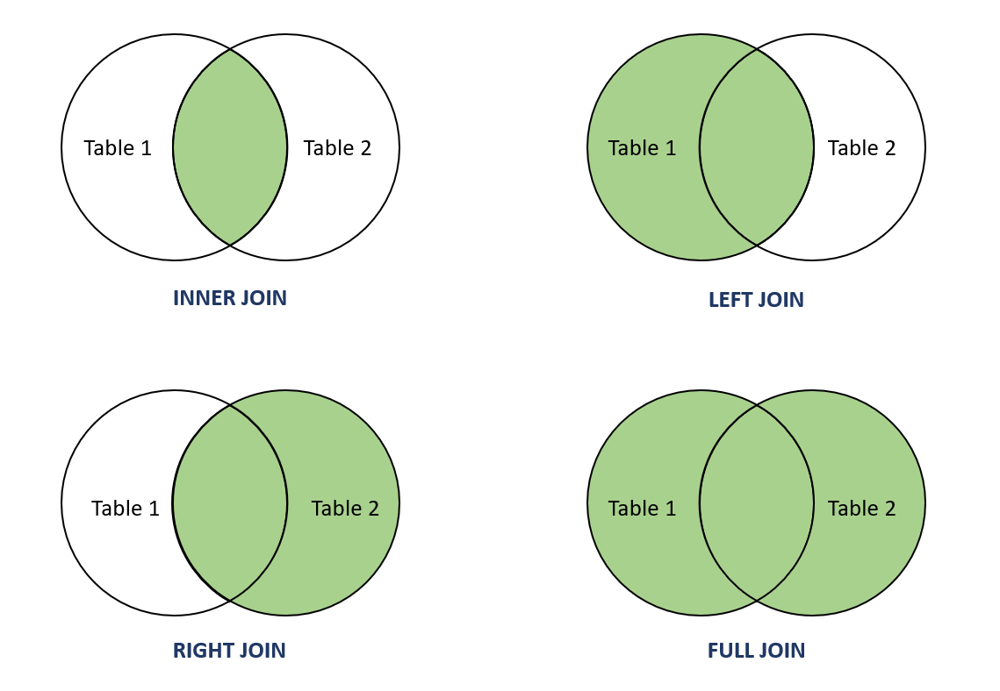

# 🔗 PostgreSQL JOINs 

In SQL, a **JOIN** combines data from two or more tables based on a related column between them.
PostgreSQL supports several types of JOINs that let you retrieve data efficiently from multiple tables.

---

- 

## 📘 1. Sample Database Setup

Let’s create two simple tables: `students` and `courses`.

```sql
CREATE TABLE students (
    id SERIAL PRIMARY KEY,
    name VARCHAR(50)
);

CREATE TABLE courses (
    id SERIAL PRIMARY KEY,
    course_name VARCHAR(50),
    student_id INT
);
```

### Insert Example Data

```sql
INSERT INTO students (name) VALUES
('Alize'),
('Greg'),
('Charlotte'),
('Paul');

INSERT INTO courses (course_name, student_id) VALUES
('Math', 1),
('Physics', 1),
('Biology', 2),
('History', 5);
```

🧠 **Observation**

* `Alize` is enrolled in **Math** and **Physics**
* `Greg` is enrolled in **Biology**
* `Charlotte` and `Paul` have **no courses**
* `History` is linked to a **non-existent student** (`student_id = 5`)

---

## 🧩 2. INNER JOIN

### 🔍 Definition

Returns **only rows that have matching values** in both tables.

### 🧠 Example

```sql
SELECT s.name, c.course_name
FROM students s
INNER JOIN courses c
ON s.id = c.student_id;
```

### ✅ Result

| name  | course_name |
|-------|-------------|
| Alize | Math        |
| Alize | Physics     |
| Greg   | Biology     |

🎯 **Explanation:**
Only students with matching records in `courses` appear.

---

## 🧩 3. LEFT JOIN (or LEFT OUTER JOIN)

### 🔍 Definition

Returns **all rows from the left table** (`students`), and the matching rows from the right table (`courses`).
If there’s no match, the result contains **NULLs** for right-side columns.

### 🧠 Example

```sql
SELECT s.name, c.course_name
FROM students s
LEFT JOIN courses c
ON s.id = c.student_id;
```

### ✅ Result

| name  | course_name |
|-------|-------------|
| Alize | Math        |
| Alize | Physics     |
| Greg   | Biology     |
| Charlotte | NULL        |
| Paul | NULL        |

🎯 **Explanation:**
All students appear, even if they are not enrolled in any course.

---

## 🧩 4. RIGHT JOIN (or RIGHT OUTER JOIN)

### 🔍 Definition

Returns **all rows from the right table** (`courses`), and the matching rows from the left table (`students`).
If there’s no match, the result contains **NULLs** for left-side columns.

### 🧠 Example

```sql
SELECT s.name, c.course_name
FROM students s
RIGHT JOIN courses c
ON s.id = c.student_id;
```

### ✅ Result

| name  | course_name |
|-------|-------------|
| Alize | Math        |
| Alize | Physics     |
| Greg   | Biology     |
| NULL  | History     |

🎯 **Explanation:**
The `History` course doesn’t have a matching student, so `name` is `NULL`.

---

## 🧩 5. FULL JOIN (or FULL OUTER JOIN)

### 🔍 Definition

Returns **all rows from both tables** — matching rows are merged, and non-matching rows appear with **NULLs**.

### 🧠 Example

```sql
SELECT s.name, c.course_name
FROM students s
FULL JOIN courses c
ON s.id = c.student_id;
```

### ✅ Result

| name  | course_name |
|-------|-------------|
| Alize | Math        |
| Alize | Physics     |
| Greg   | Biology     |
| Charlotte | NULL        |
| Paul | NULL        |
| NULL  | History     |

🎯 **Explanation:**
Shows **all data** — including unmatched students and unmatched courses.

---

## 🧠 Quick Summary

| JOIN Type      | Description                         | Shows Unmatched? | Supported in PostgreSQL |
|----------------|-------------------------------------|------------------|-------------------------|
| **INNER JOIN** | Only matching rows from both tables | ❌ No             | ✅ Yes                   |
| **LEFT JOIN**  | All left + matching right           | ✅ Left only      | ✅ Yes                   |
| **RIGHT JOIN** | All right + matching left           | ✅ Right only     | ✅ Yes                   |
| **FULL JOIN**  | All rows from both tables           | ✅ Both sides     | ✅ Yes                   |


---

## 💡 Pro Tips for PostgreSQL JOINs

* ⚙️ Use **INNER JOIN** for most relational data operations.
* 🧩 Use **FULL JOIN** when you need *everything*, even unmatched data.
* 🧠 Keep joins simple and readable — indentation helps.

---

