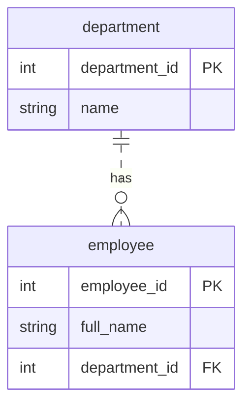
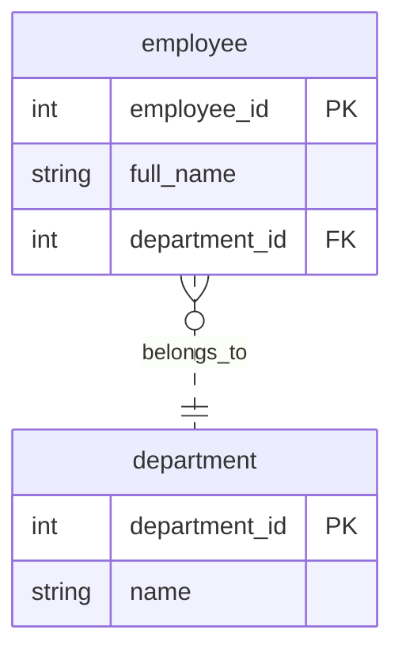
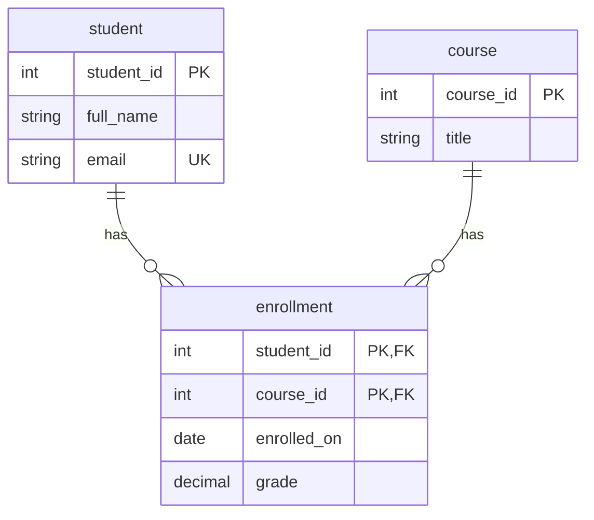

# Relationships and JOINs

So far, we have mainly worked with one table. Now we will connect data from different tables.

We will start with departments and employees to learn **one-to-many**, **many-to-one**, and **foreign keys**. Then we will move to students and courses to learn **many-to-many** and JOINs.

> The department–employee example is separate from [setup.sql](setup.sql). Its SQL below is a small, optional practice example. From section 5 onward, use the shared setup with `student`, `course`, and `enrollment`.

## 1. Moving from one table to two

Imagine a company with several departments.

**In this example, each employee works in exactly one department. A department can have several employees.**

We could repeat the department name beside every employee. But if the department name changed, we would need to update several rows.

Instead, we store departments and employees separately.

**department**

| department_id | name |
| --- | --- |
| 10 | Engineering |
| 20 | Education |
| 30 | Finance |

**employee**

| employee_id | full_name | department_id |
| --- | --- | --- |
| 1 | Charlotte | 10 |
| 2 | Paul | 10 |
| 3 | Gayatri | 20 |

The `department_id` in each employee row tells us which department that employee belongs to.

Charlotte and Paul both belong to Engineering. Gayatri belongs to Education. Finance has no employees yet.

## 2. One-to-many and many-to-one

Look at the same data from two directions:

| Starting point | Question | Relationship |
| --- | --- | --- |
| One department | How many employees can work here? Several. | **One-to-many** |
| One employee | How many departments does this employee belong to? One. | **Many-to-one** |

**These are two views of the same relationship.** We do not need a separate table or a different design for each direction.

“Many” describes what the design allows. It does not mean every department must already have several employees. In our example, a department can have zero, one, or many employees.

Our rule that each employee has only one department is a choice for this example. A different business rule could require a different design.

### Show the relationship in a diagram

An **entity-relationship (ER) diagram** shows tables, columns, and relationships. `PK` marks a primary key and `FK` marks a foreign key.

**One-to-many: start with department.**



Read this as: **one department can have zero or many employees.**

**Many-to-one: start with employee.**



Read this as: **each employee belongs to exactly one department.**

These diagrams show the same tables and the same relationship. Only the reading direction changes.

| Symbol | Meaning |
| --- | --- |
| // | beside department | Each employee has exactly one department. |
| `o{` or `}o` beside employee | Each department can have zero or many employees. |

The words `has` and `belongs_to` are labels we choose. Read the label from the first table written in the Mermaid code. The layout may place the tables differently on screen.

## 3. What is a foreign key?

A **primary key** identifies one row in a table.

- `department.department_id` identifies a department.
- `employee.employee_id` identifies an employee.

A **foreign key** references a key in another table. It connects related records and helps prevent invalid references.

Here, `employee.department_id` references `department.department_id`.

| Column | Role | Can its value repeat in this table? |
| --- | --- | --- |
| `department.department_id` | Primary key | No |
| `employee.employee_id` | Primary key | No |
| `employee.department_id` | Foreign key | Yes: several employees can share a department |

**For this one-to-many relationship, the foreign key goes on the “many” side: the employee table.**

Here is the SQL for our separate practice example. Run it once before doing the exercises at the end of section 4:

```sql
CREATE TABLE department (
    department_id INT PRIMARY KEY,
    name VARCHAR(100) NOT NULL
);

CREATE TABLE employee (
    employee_id INT PRIMARY KEY,
    full_name VARCHAR(100) NOT NULL,
    department_id INT NOT NULL,
    FOREIGN KEY (department_id)
        REFERENCES department(department_id)
);

INSERT INTO department (department_id, name)
VALUES (10, 'Engineering'), (20, 'Education'), (30, 'Finance');

INSERT INTO employee (employee_id, full_name, department_id)
VALUES (1, 'Charlotte', 10), (2, 'Paul', 10), (3, 'Gayatri', 20);
```

Read the foreign-key rule as:

> Every department ID stored in employee must refer to an existing department.

For example, this statement fails because department `999` does not exist:

```sql
-- Expected error: the referenced department does not exist.
INSERT INTO employee (employee_id, full_name, department_id)
VALUES (4, 'Nikita', 999);
```

The two constraints have different jobs:

- `NOT NULL` requires an employee to have a department ID.
- `FOREIGN KEY` requires that ID to refer to an existing department.

A foreign key does not automatically display the department name. For that, we use a JOIN.

## 4. Read related data with INNER JOIN

```sql
SELECT e.full_name, d.name AS department_name
FROM employee AS e
INNER JOIN department AS d
    ON e.department_id = d.department_id
ORDER BY e.employee_id;
```

| full_name | department_name |
| --- | --- |
| Charlotte | Engineering |
| Paul | Engineering |
| Gayatri | Education |

- `e` and `d` are **table aliases**: short names used in this query.
- `e.department_id` means the department ID from the employee table.
- `ON` describes which rows match.
- `INNER JOIN` returns matching pairs of rows.
- `AS department_name` gives the output column a clear name.

Each result row represents one employee and their department. Engineering appears twice because it has two employees.

`JOIN` on its own means `INNER JOIN`.

**A foreign key protects stored data. A JOIN combines related values in a query result.** A JOIN does not change the stored tables, and it can work without a declared foreign key.

### SQL practice

Use only `department` and `employee` for these exercises. Complete tasks 1–4 before changing the data in task 5. You do not need LEFT JOIN or GROUP BY yet.

**1. Find Engineering employees**

Show each employee's name and department name, but only for Engineering. Filter by the department name, not its ID. Sort by employee name.

Expected names: Charlotte and Paul.

**2. Start from the other table**

Rewrite the JOIN from this section with `FROM department AS d`, then join `employee AS e`. Show the same columns and sort by employee ID.

Do you get the same three rows? Explain why changing the starting table does not change the matching pairs in this INNER JOIN.

**3. Find Paul's department**

Write a query that returns Paul's name and his department name.

Expected department: Engineering.

**4. Fix the matching condition**

This query returns no rows with our current data:

```sql
SELECT e.full_name, d.name AS department_name
FROM employee AS e
JOIN department AS d
    ON e.employee_id = d.department_id;
```

Which column should replace `e.employee_id`? Explain why two columns having the same data type does not mean they represent the same thing.

**5. Add an employee and check the relationship**

Insert Nikita with employee ID `4` into Education. Then write a JOIN query to show everyone in Education.

Expected names: Gayatri and Nikita.

Before running anything else, predict what would happen if you updated Nikita's department ID to `999`. Which constraint would reject it?

### Design practice

For each scenario, draw a small ER diagram, mark the primary and foreign keys, and write the two `CREATE TABLE` statements. You may draw on paper or use Mermaid.

**1. Customers and orders**

A customer can place zero or many orders. Each order belongs to exactly one customer.

- Store the customer's ID, name, and email.
- Store the order's ID and order date.
- Choose where to put the foreign key. Should it allow NULL?
- Explain the relationship in both directions.
- Why should the customer's email not be copied into every order?

Use `customer` and `customer_order` as table names; `ORDER` is an SQL keyword.

**2. Categories and products**

In this shop, each product belongs to exactly one category. A category can contain zero or many products.

- Store the category's ID and name.
- Store the product's ID, name, and price.
- Add the foreign key to the correct table.
- Can two products share the same category ID? Why?
- If a category name changes, which table should be updated?

Use `category` and `product` as table names. Follow the one-category-per-product rule for this exercise.

## 5. Many To Many Relations

Return to the shared data in [setup.sql](setup.sql).

Students and courses have a different rule:

- One student can attend many courses.
- One course can have many students.

This is a **many-to-many** relationship.

A single `course_id` in `student` would allow only one course per student. A single `student_id` in `course` would allow only one student per course.

Instead, we use a third table: `enrollment`. This is called a **junction table**.

| Table | What one row represents |
| --- | --- |
| `student` | One student |
| `course` | One course |
| `enrollment` | One student attending one course |

For example, these enrollment rows connect students to courses:

| student_id | course_id |
| --- | --- |
| 1 | 10 |
| 1 | 20 |
| 1 | 30 |
| 2 | 10 |
| 2 | 20 |

Student `1` attends three courses. Course `10` has students `1` and `2`.

**The junction table turns one many-to-many relationship into two one-to-many relationships:**

- One student can have many enrollments. Each enrollment belongs to one student.
- One course can have many enrollments. Each enrollment belongs to one course.

## 6. Keys in the junction table

This definition is already in the shared setup. Do not recreate it:

```sql
CREATE TABLE enrollment (
    student_id INT NOT NULL,
    course_id INT NOT NULL,
    enrolled_on DATE NOT NULL,
    grade NUMERIC(5,2) CHECK (grade BETWEEN 0 AND 100),
    PRIMARY KEY (student_id, course_id),
    FOREIGN KEY (student_id) REFERENCES student(student_id),
    FOREIGN KEY (course_id) REFERENCES course(course_id)
);
```

There are two foreign keys:

- `student_id` must reference an existing student.
- `course_id` must reference an existing course.

The **composite primary key** uses two columns together. Each student–course pair must be unique.

Student `1` may appear several times. Course `10` may appear several times. But the pair `(1, 10)` can appear only once. This model allows one enrollment per student per course; retakes would need a different design.

The date and grade belong in `enrollment` because they describe a student's participation in a particular course. A grade may be `NULL` if it has not been recorded. Recorded grades must be between 0 and 100.

## 7. Read an ER diagram

An **entity-relationship diagram** shows tables and their relationships.



- `||` means exactly one.
- `o{` means zero or many.
- `PK` means primary key; `FK` means foreign key; `UK` means unique key.

Read the first relationship in both directions:

> One student can have zero or many enrollments.  
> Each enrollment belongs to exactly one student.

The symbol beside a table tells you how many of its rows can relate to one row on the other side.

The label `has` is a description we choose, not a SQL keyword.

**Discuss:** Why does a student's email belong in `student`, but their course grade belongs in `enrollment`?

## 8. Join students and enrollments

```sql
SELECT s.full_name, e.course_id, e.grade
FROM student AS s
JOIN enrollment AS e
    ON s.student_id = e.student_id
ORDER BY s.student_id, e.course_id;
```

| full_name | course_id | grade |
| --- | --- | --- |
| Kien Ahmed | 10 | 80 |
| Kien Ahmed | 20 | 90 |
| Kien Ahmed | 30 | NULL |
| Malek Janssen | 10 | 70 |
| Malek Janssen | 20 | 80 |
| Charlotte Peeters | 20 | 100 |
| Gayatri Yilmaz | 10 | 90 |

Each result row represents one enrollment with its student's name.

Kien appears three times because she has three enrollments. Paul does not appear because he has none.

Kien's missing grade does not prevent a match: our `ON` condition compares student IDs, not grades.

## 9. Add course titles with another JOIN

```sql
SELECT s.full_name, c.title, e.grade
FROM student AS s
JOIN enrollment AS e
    ON s.student_id = e.student_id
JOIN course AS c
    ON e.course_id = c.course_id
ORDER BY s.student_id, c.course_id;
```

The first JOIN connects students to enrollments. The second connects enrollments to courses.

The result still has seven rows:

| full_name | title | grade |
| --- | --- | --- |
| Kien Ahmed | Java | 80 |
| Kien Ahmed | SQL | 90 |
| Kien Ahmed | Spring Boot | NULL |
| Malek Janssen | Java | 70 |
| Malek Janssen | SQL | 80 |
| Charlotte Peeters | SQL | 100 |
| Gayatri Yilmaz | Java | 90 |

Do not match a student ID directly to a course ID. They identify different things. The enrollment table tells us which students attend which courses.

### Videos to Understand How Databases Store Data
https://www.youtube.com/watch?v=0khUgS5VkAg How Databases Store Data
https://www.youtube.com/watch?v=K1a2Bk8NrYQ Understanding B-Trees: The Data Structure Behind Modern Databases
https://www.youtube.com/watch?v=YuRO9-rOgv4 How do SQL Indexes Work (we'll watch this at a later time) (edited)


## 10. Keep unmatched students with LEFT JOIN

What if we want every student, including students with no enrollments?

```sql
SELECT s.full_name, c.title, e.grade
FROM student AS s
LEFT JOIN enrollment AS e
    ON s.student_id = e.student_id
LEFT JOIN course AS c
    ON e.course_id = c.course_id
ORDER BY s.student_id, c.course_id;
```

A **LEFT JOIN** keeps every row from its left input. When no match exists, the right-side columns contain `NULL` in the result.

We get the previous seven rows plus:

| full_name | title | grade |
| --- | --- | --- |
| Paul Janssens | NULL | NULL |

Both JOINs are LEFT JOINs so Paul remains in the final result. An INNER JOIN to `course` would remove his row because it has no matching course.

LEFT JOIN does not mean one result row per student. Kien still has three enrollments, so she still appears three times.

## 11. Find students without enrollments

```sql
SELECT s.full_name
FROM student AS s
LEFT JOIN enrollment AS e
    ON s.student_id = e.student_id
WHERE e.student_id IS NULL
ORDER BY s.student_id;
```

This returns Paul.

A real enrollment cannot have a null `student_id`. Here, its `NULL` value tells us that the JOIN found no enrollment.

Checking `e.grade IS NULL` would also include Kien: she has an enrollment whose grade is missing.

## 12. Optional challenge: ON or WHERE?

We want every student, showing their SQL enrollment if they have one:

```sql
SELECT s.full_name, e.course_id
FROM student AS s
LEFT JOIN enrollment AS e
    ON s.student_id = e.student_id
   AND e.course_id = 20
ORDER BY s.student_id;
```

All five students appear. Kien, Malek, and Charlotte have course `20`. Paul and Gayatri have `NULL`.

Now move `e.course_id = 20` into a WHERE clause. Which students disappear?

- `ON` decides which rows match.
- `WHERE` filters the joined result.

The WHERE version removes Paul and Gayatri because `NULL = 20` is not true.


### UUID as a primary key
Before we have used int columns as primary key, but we can also use Universally Unique Identifiers as well. It is a datatype in PostgreSql.
gen_random_uuid()

```sql
CREATE TABLE IF NOT EXISTS public.student_uuid
(
uuid uuid NOT NULL,
CONSTRAINT student_uuid_pkey PRIMARY KEY (uuid)
)

insert into student (id)
values (gen_random_uuid())
```

## Before moving on

Make sure you can explain:

1. Why are one-to-many and many-to-one the same relationship viewed from different sides?
2. Where does the foreign key go in our department–employee example?
3. Why does a many-to-many relationship need a junction table?
4. What does one output row represent in each JOIN query?
5. When should unmatched rows remain?

Reference: [PostgreSQL joins](https://www.postgresql.org/docs/16/tutorial-join.html).

