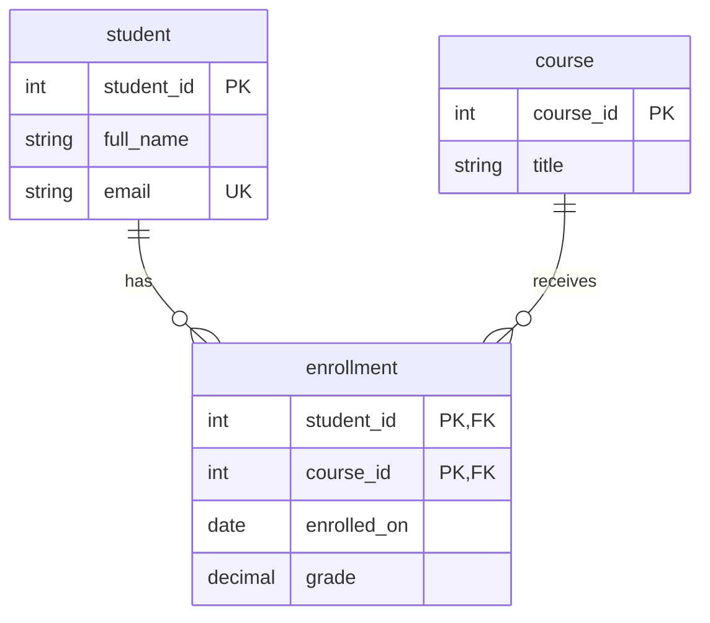

# Relationships and JOINs

So far, we have mainly asked questions about one table. Now we want to answer: “Which students attend which courses?” The student's name and the course title are stored in different tables, so we need to connect their rows.

Use [setup.sql](setup.sql) for the shared data. This lesson explains the tables it creates and then queries them together.

## 1. Why separate the data?

Imagine storing a student's name, email, and course title in one table. Kien takes three courses, so her email would be repeated three times. If it changed, we would need to update all three copies consistently.

Instead, we store each student once and each course once. An enrollment records the fact that a particular student attends a particular course.

| Table | What one row represents |
| --- | --- |
| `student` | One student |
| `course` | One course |
| `enrollment` | One student attending one course |

This is an introduction to relational design: put each fact where it belongs, then connect related facts using keys.

## 2. One-to-many and many-to-one

Kien has three enrollments. Each enrollment belongs to one student. From students to enrollments, this is **one-to-many**. From enrollments to students, it is **many-to-one**: the same relationship viewed from the other side.

“Many” describes what the design allows, not how many rows must exist today. Paul is a student with no enrollments.

## 3. Many-to-many needs a junction table

A student can attend several courses, and a course can contain several students. We represent this **many-to-many** relationship with a junction table, `enrollment`.

This definition is already in setup; do not recreate the table:

```sql
CREATE TABLE enrollment (
    student_id INT NOT NULL,
    course_id INT NOT NULL,
    enrolled_on DATE NOT NULL,
    grade NUMERIC(5,2) CHECK (grade BETWEEN 0 AND 100),
    PRIMARY KEY (student_id, course_id),
    FOREIGN KEY (student_id) REFERENCES student(student_id),
    FOREIGN KEY (course_id) REFERENCES course(course_id)
);
```

The **composite primary key** makes each student–course pair unique. Student `1` can appear in several rows, and course `10` can appear in several rows, but the pair `(1, 10)` can appear only once. Our model assumes one enrollment per student per course; supporting retakes would require a different design.

The **foreign keys** ensure that the referenced student and course exist. A non-null student ID of `999` would be rejected because no such student exists. A foreign key does not require every student to enroll, and it does not retrieve a student's name for us.

The enrollment date and grade belong here because they describe this student's participation in this course. A missing grade is allowed; the check restricts recorded grades to 0–100.

## 4. Read the relationships in an ER diagram

An entity-relationship diagram shows tables and how they connect:



`||` means exactly one; the circle and crow's foot mean zero or many. Each enrollment has exactly one student and one course. Each student or course may have zero or many enrollments.

The diagram shows selected columns. `PK` marks a primary-key column, `FK` a foreign-key column, and `UK` a unique key.

**Discuss:** why can we store Kien's email in `student`, but not her course grade?

## 5. Match rows with INNER JOIN

```sql
SELECT s.full_name, e.course_id, e.grade
FROM student AS s
INNER JOIN enrollment AS e
    ON s.student_id = e.student_id
ORDER BY s.student_id, e.course_id;
```

`s` and `e` are table aliases: short names used within this query. `s.student_id` means the student ID from the student table.

The `ON` condition tells PostgreSQL which rows belong together. For each matching student–enrollment pair, the query returns one result row. `JOIN` on its own means `INNER JOIN`.

| full_name | course_id | grade |
| --- | --- | --- |
| Kien Ahmed | 10 | 80 |
| Kien Ahmed | 20 | 90 |
| Kien Ahmed | 30 | NULL |
| Malek Janssen | 10 | 70 |
| Malek Janssen | 20 | 80 |
| Charlotte Peeters | 20 | 100 |
| Gayatri Yilmaz | 10 | 90 |

Kien appears three times because she has three enrollments. Paul does not appear because he has no match. Kien's unrecorded grade does not prevent the match: the join condition compares student IDs, not grades.

**A foreign key protects stored data; a JOIN constructs a query result.** A JOIN can work without a declared foreign key, provided its matching condition makes sense. It does not merge or change the stored tables.

## 6. Add the course title

```sql
SELECT s.full_name, c.title, e.grade
FROM student AS s
JOIN enrollment AS e
    ON s.student_id = e.student_id
JOIN course AS c
    ON e.course_id = c.course_id
ORDER BY s.student_id, c.course_id;
```

The first join connects students to enrollments. The second connects each enrollment to its course. We still get seven rows, but course IDs are now presented as titles: Java, SQL, or Spring Boot.

Do not join a student ID directly to a course ID. Both are integers, but they identify different things. The enrollment table records which pairs are related.

## 7. Keep unmatched students with LEFT JOIN

```sql
SELECT s.full_name, c.title, e.grade
FROM student AS s
LEFT JOIN enrollment AS e
    ON s.student_id = e.student_id
LEFT JOIN course AS c
    ON e.course_id = c.course_id
ORDER BY s.student_id, c.course_id;
```

A `LEFT JOIN` keeps every row from its left input. If there is no match, columns from the right side are filled with `NULL` in the result.

This query returns the previous seven rows plus:

| full_name | title | grade |
| --- | --- | --- |
| Paul Janssens | NULL | NULL |

Both joins are left joins so Paul survives the whole chain. Notice that `LEFT JOIN` does not guarantee exactly one result row per student: Kien still has three matches.

## 8. Find students without enrollments

```sql
SELECT s.full_name
FROM student AS s
LEFT JOIN enrollment AS e
    ON s.student_id = e.student_id
WHERE e.student_id IS NULL
ORDER BY s.student_id;
```

This returns Paul. We check a right-side key that cannot be null in a real enrollment. Its null value here tells us that the join found no enrollment.

Checking `e.grade IS NULL` would answer a different question: it would also include Kien, who has an enrollment with an unrecorded grade.

## 9. Be careful where you filter

Suppose we want every student, showing their SQL enrollment if they have one:

```sql
SELECT s.full_name, e.course_id
FROM student AS s
LEFT JOIN enrollment AS e
    ON s.student_id = e.student_id
   AND e.course_id = 20
ORDER BY s.student_id;
```

All five students appear. Kien, Malek, and Charlotte have course `20`; Paul and Gayatri have `NULL` in the result.

Moving `e.course_id = 20` into `WHERE` would remove the unmatched rows, because `NULL = 20` is not true. The condition in `ON` determines matching; the condition in `WHERE` filters the joined result.

## Before moving on

Ask three questions about each join: what does one output row represent, which columns connect the tables, and should unmatched rows remain?

`INNER JOIN` and `LEFT JOIN` cover our main examples. [psql-join.md](psql-join.md) is an optional reference for `RIGHT JOIN`, `FULL JOIN`, and `CROSS JOIN`; it is not a second required lesson on the same material.


Reference: [PostgreSQL joins](https://www.postgresql.org/docs/16/tutorial-join.html).
